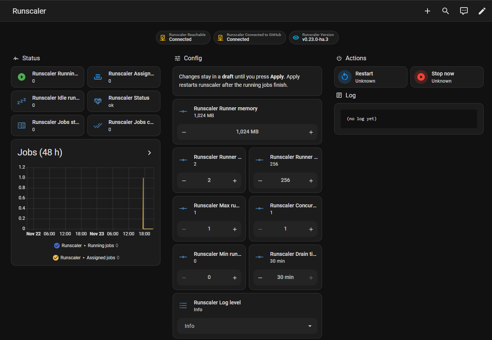

# ha-runscaler

Home Assistant integration for [runscaler](https://github.com/PatrikGuerra/runscaler/tree/feature/homeassistant), a fork of [ysya/runscaler](https://github.com/ysya/runscaler) that runs ephemeral GitHub Actions runners as Docker containers.

The integration shows the runner state, jobs, disk and log in Home Assistant. It can also change a closed list of settings, and restart or stop runscaler.

## The runscaler side

This integration needs the fork, not upstream runscaler. Everything it relies on lives on the fork's [`feature/homeassistant`](https://github.com/PatrikGuerra/runscaler/tree/feature/homeassistant) branch:

| Part | Where |
|---|---|
| Request handling (the trust boundary) | [`internal/inbox`](https://github.com/PatrikGuerra/runscaler/tree/feature/homeassistant/internal/inbox) |
| JSON contract | [`internal/inbox/testdata/contract`](https://github.com/PatrikGuerra/runscaler/tree/feature/homeassistant/internal/inbox/testdata/contract) |
| Host setup and compose file | [`deploy/homeassistant`](https://github.com/PatrikGuerra/runscaler/tree/feature/homeassistant/deploy/homeassistant) |
| Image | `ghcr.io/patrikguerra/runscaler:v0.23.0-ha.3` (arm64 and amd64), built by [`images.yml`](https://github.com/PatrikGuerra/runscaler/blob/feature/homeassistant/.github/workflows/images.yml) on `v*-ha.*` tags |

The fork is distributed under the [Sustainable Use License](https://github.com/PatrikGuerra/runscaler/blob/feature/homeassistant/LICENSE), like upstream.

## How it works

```text
Home Assistant (network_mode: host)
  ├── GET   http://127.0.0.1:8089/healthz            → sensors
  ├── read  /runscaler-exchange/outbox/*.json        → current config, request result
  ├── read  /runscaler-exchange/logs/runner.log      → log
  └── write /runscaler-exchange/inbox/request.json   → request
runscaler: internal/inbox validates the request → applies it → drains → restarts
```

The integration never talks to Docker. It only writes a JSON request. runscaler decides: it rejects any field outside the allowlist and always copies the fixed fields (`dind`, socket, network, GitHub App) from the current config.

A copy of the fork's contract lives in `tests/fixtures/contract/`, and the tests check that the integration writes the same shape.

## Requirements

- Home Assistant **Container** 2026.11 or newer.
- runscaler from the fork, with `RUNNER_EXCHANGE_DIR` set, `/healthz` published on `127.0.0.1:8089`, and `log-file = "/var/log/runner/runner.log"` with `exchange/logs` mounted there (runscaler running as root only logs under `/var/log`). See [`deploy/homeassistant/README.md`](https://github.com/PatrikGuerra/runscaler/blob/feature/homeassistant/deploy/homeassistant/README.md) in the fork.
- The host folder `/opt/runscaler/exchange` mounted into the Home Assistant container at `/runscaler-exchange`.

## Install

### With HACS (recommended)

[](https://my.home-assistant.io/redirect/hacs_repository/?owner=PatrikGuerra&repository=ha-runscaler&category=integration)

1. Install [HACS](https://hacs.xyz/docs/use/download/download/) if you don't have it yet.
2. In HACS, open **⋮ → Custom repositories**.
3. Paste `https://github.com/PatrikGuerra/ha-runscaler`, pick type **Integration**, and click **Add**.
4. Search for **Runscaler** in HACS and click **Download**.
5. Restart Home Assistant.

HACS shows new releases as updates in **Settings → Updates**.

### Manually

Copy `custom_components/runscaler` from the [latest release](https://github.com/PatrikGuerra/ha-runscaler/releases/latest) to `/config/custom_components/runscaler` in Home Assistant, then restart it. For a Home Assistant Container whose `/config` is `/opt/homeassistant/config` on the host:

```bash
scp -r custom_components/runscaler <user>@<host>:/tmp/runscaler
ssh <user>@<host> 'sudo mkdir -p /opt/homeassistant/config/custom_components && sudo rm -rf /opt/homeassistant/config/custom_components/runscaler && sudo mv /tmp/runscaler /opt/homeassistant/config/custom_components/'
```

### Set it up

1. Go to **Settings → Devices & services → Add integration** and search for **Runscaler**.
2. Accept the defaults:

   | Field | Default |
   |---|---|
   | Health URL | `http://127.0.0.1:8089/healthz` |
   | Exchange folder | `/runscaler-exchange` |

## Releasing

1. Bump `version` in `custom_components/runscaler/manifest.json`, for example to `0.2.0`.
2. Merge it, then push a matching tag: `git tag v0.2.0 && git push origin v0.2.0`.
3. The `Release` workflow checks that the tag matches `manifest.json` and publishes a GitHub release. HACS picks it up.

## Entities

Entity ids are always in English, whatever the Home Assistant language.

| Kind | Entities |
|---|---|
| State | `binary_sensor.runscaler_reachable`, `binary_sensor.runscaler_connected`, `sensor.runscaler_status`, `sensor.runscaler_assigned_jobs`, `sensor.runscaler_running_jobs`, `sensor.runscaler_idle_runners`, `sensor.runscaler_jobs_started`, `sensor.runscaler_jobs_completed`, `sensor.runscaler_disk_free`, `sensor.runscaler_last_error`, `sensor.runscaler_version` |
| Log | `sensor.runscaler_last_log_line`. The `lines` attribute holds the last 50 lines and is not stored in the recorder |
| Config (draft) | `text.runscaler_url`, `text.runscaler_name`, `text.runscaler_runner_image`, `number.runscaler_max_runners`, `number.runscaler_concurrent`, `number.runscaler_min_runners`, `number.runscaler_docker_memory`, `number.runscaler_docker_cpu`, `number.runscaler_docker_pids_limit`, `number.runscaler_drain_timeout`, `select.runscaler_log_level` |
| Request | `binary_sensor.runscaler_pending_changes`, `sensor.runscaler_last_request` (`pending` / `applied` / `rejected` / `timeout`) |
| Buttons | `button.runscaler_apply_config`, `button.runscaler_discard_changes`, `button.runscaler_restart`, `button.runscaler_stop_now` |

Entity names come in English and Brazilian Portuguese. Home Assistant picks them from the **system** language (Settings → System → General), not from your user profile.

### Changing the config

Changing a field does **not** touch runscaler. It only changes a draft, and `binary_sensor.runscaler_pending_changes` turns on. **Apply config** sends all fields at once. runscaler validates them, waits for running jobs to finish, and restarts.

- The draft lives in memory only. If Home Assistant restarts, it goes back to the current config.
- Only one request can be pending. A second one fails until the first gets an answer.
- If runscaler rejects the request or does not answer within 120 s, Home Assistant shows a notification and fires the `runscaler_request_finished` event.

## Dashboard



`examples/dashboard.yaml` is a one-page dashboard with built-in cards only (no HACS):

| Section | Shows |
|---|---|
| Badges | Reachable, connected to GitHub, version |
| Status | Running and assigned jobs, idle runners, counters, disk gauge, last error (only when there is one), 48 h job graph |
| Config | Draft fields with +/- buttons, log level picker, text fields, **Apply** and **Discard**, last request |
| Actions | **Restart** and **Stop now**, both with a confirmation |
| Log | Last 25 log lines |

To apply it:

1. Go to **Settings → Dashboards → Add dashboard → New dashboard from scratch**. Name it `Runscaler` and click **Create**.
2. Open the new dashboard and click the pencil (**Edit dashboard**).
3. Click **⋮ → Raw configuration editor**.
4. Delete everything there and paste the content of `examples/dashboard.yaml`.
5. Click **Save**, then close the editor (X).

Use a **new** dashboard. The raw editor replaces the whole dashboard, so pasting into an existing one deletes its cards.

If you see `No type provided`, you pasted it into a single card's editor. Use the raw configuration editor of the dashboard instead. If you see `Entity not available`, the integration is not set up yet.

## Notifications

`examples/automations.yaml` has three automations:

| Automation | Fires when |
|---|---|
| `Runscaler disconnected from GitHub` | runscaler is unreachable or disconnected for 5 minutes |
| `Runscaler low disk` | Free disk drops below 15% (needs `[disk] guard = true` in runscaler) |
| `Runscaler request failed` | A request ends as `rejected` or `timeout` |

They notify through `notify.persistent_notification`, the bell in the sidebar. To get them on your phone, install the Home Assistant Companion app, then use its action instead. Find its name in **Developer tools → Actions** by searching `notify.mobile_app`.

To apply them, one at a time, in the UI:

1. Go to **Settings → Automations & scenes → Create automation → Create new automation**.
2. Click **⋮ → Edit in YAML**.
3. Delete everything there and paste **one** automation from the file, without the leading `- `, and with its lines moved two spaces left.
4. Optional: change `notify.persistent_notification` to your `notify.mobile_app_<device>`.
5. Click **Save**. Repeat for the other two.

Or all at once, in the file:

1. Append the content of `examples/automations.yaml` to `/config/automations.yaml`. Keep what is already there. The `id` values must not repeat.
2. Go to **Developer tools → YAML → Check configuration**.
3. Click **Automations** under **YAML configuration reloading**.

To test a notification, open the automation, click **⋮ → Run actions**, and check the bell.

## Security

- Home Assistant has no per-entity permissions. **Any Home Assistant user** can apply a config or stop the runner.
- `/healthz` listens only on `127.0.0.1`. It is not on the home network, and jobs cannot reach it.
- Replacing the GitHub App `.pem` does not go through the integration. Copy it with `scp`.

## Development

```bash
python3.14 -m venv .venv && . .venv/bin/activate
pip install -r requirements_test.txt
pytest -q
```

`tests/test_exchange.py` does not need Home Assistant, so it runs on any Python 3.12+. The other tests use `pytest-homeassistant-custom-component`, which needs Python 3.14 and does not run on Windows. CI runs everything.
